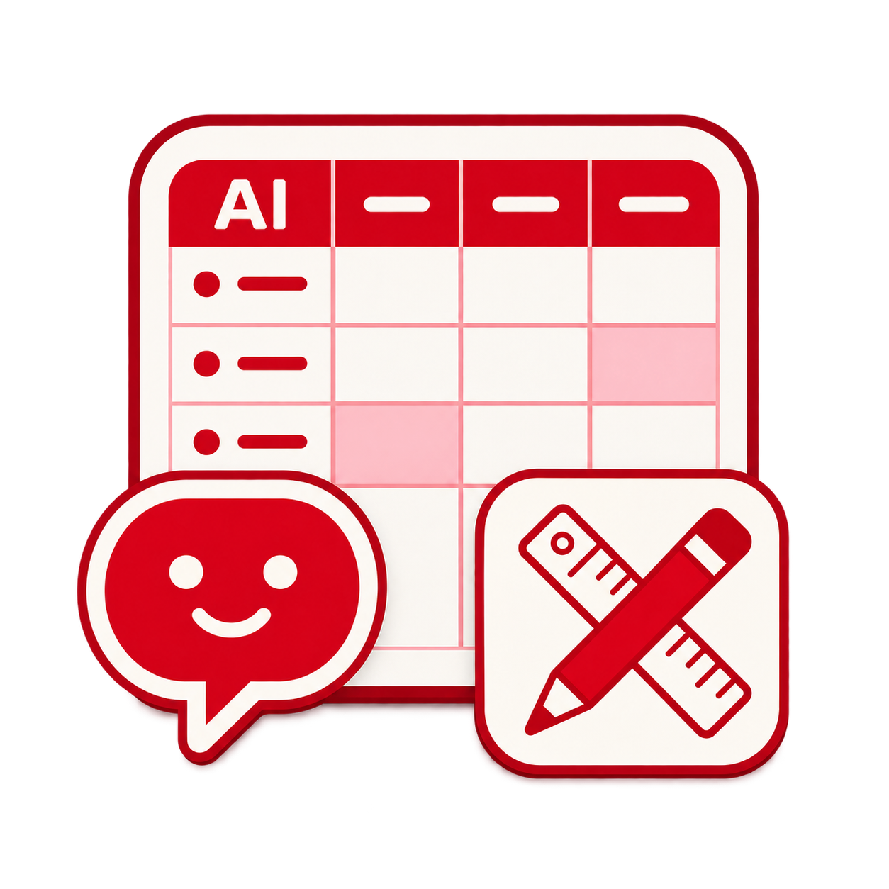

<p align="center">
  
</p>

<h3 align="center">Select AI APEX</h3>

<p align="center">Deploy an Oracle APEX application that lets users ask questions in natural language over selected Oracle Autonomous Database schemas.</p>

<p align="center">
  <a href="LICENSE"></a>
  <a href="https://github.com/jgangini/select-ai-apex/releases"></a>
  <a href="https://github.com/jgangini/select-ai-apex/actions/workflows/checks.yml"></a>
</p>

<p align="center"><strong>Technologies</strong></p>

<p align="center">
  <a href="terraform/"></a>
  <a href="apex/manifest.json"></a>
  <a href="pyproject.toml"></a>
</p>

<p align="center">
  <a href="#quick-start">Quick start</a> ·
  <a href="docs/architecture.md">Architecture</a> ·
  <a href="docs/tutorial.md">Tutorial</a> ·
  <a href="docs/testing.md">Testing</a>
</p>

## Quick start

Open [Deploy Studio](https://cloudtechnext.net/#deploy) with an OCI API signing profile, permission to deploy in the target compartment, and a subscribed region that offers an OCI Generative AI chat model.

1. Select **Select AI APEX** and [v1.3.7](https://github.com/jgangini/select-ai-apex/releases/tag/v1.3.7) or a newer release. **Autonomous DB + Select AI** installs **Ask Oracle Select AI 5.0.0.2**, which requires **Oracle APEX 26.1.6 or later**. Attach the OCI config and API private key.
2. For a first test, choose **Create new**, select Oracle AI Database 26ai in a region with the required APEX version, and use the **Sales History (SH_DEMO)** schema. Choose an available chat model and keep **Autonomous DB + Select AI** selected under **APEX application**.
3. Enter the Database ADMIN, wallet, and APEX workspace passwords. Select **Validate**, then **Deploy**.
4. When the job succeeds, open the APEX URL, sign in with the workspace user, and ask for total sales by year. The [tutorial](docs/tutorial.md) walks through this check and the steps for reusing an existing database.

To inspect the installer locally from the repository root:

```powershell
py -3.11 -m venv .venv
.\.venv\Scripts\python.exe -m pip install -e .
.\.venv\Scripts\select-ai-apex.exe --help
```

## Documentation

- [Architecture](docs/architecture.md) covers infrastructure, APEX, Select AI, and how access is scoped to selected objects.
- [Tutorial](docs/tutorial.md) walks through a Sales History deployment and an existing database installation.
- [Testing](docs/testing.md) explains preflight, fixture-based checks, and live acceptance.
- [Security model](docs/security-model.md) covers object grants and credential handling.
- [Oracle documentation and notices](docs/official-sources.md) links to the referenced service and API documentation.
