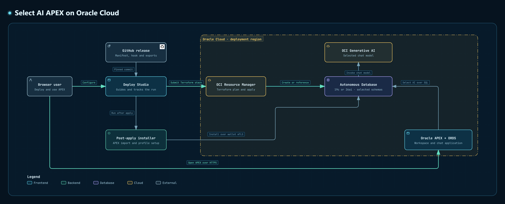

# Architecture

Select AI APEX puts the application and its data in Oracle Autonomous Database. Deploy Studio orchestrates provisioning through OCI Resource Manager, then runs a Python installer to configure Select AI and import the APEX application. The browser reaches the installed application over HTTPS through Oracle REST Data Services (ORDS).

Deploy Studio and Resource Manager handle provisioning. At runtime, APEX uses the Select AI profile in Autonomous Database and the profile uses a chat model from OCI Generative AI.

## Components

| Component | Responsibility |
| --- | --- |
| [Deploy Studio contract](../terraform/deploy-studio.json) | Describes inputs, progress steps, outputs, and the post-apply entry point. Deploy Studio pins the selected release to a Git commit. |
| [OCI Resource Manager stack](../terraform/) | Runs Terraform to create Autonomous Database with APEX and ORDS enabled, or reference an existing database. Resource Manager uses its managed OCI provider authentication. |
| [Autonomous Database and wallet](../terraform/database.tf) | Provides the data and APEX runtime. The installer connects using a database wallet. |
| [Post-apply hook](../deploy/hooks/post_apply.py) | Stages the selected APEX export and relevant demo assets from the release archive, runs the installer, and returns the application URL and deployment report. |
| [Python installer](../installer/cli.py) | Prepares the parsing schema, grants access to selected data, sets up the workspace, creates the Select AI profile, and imports the application. |
| [Ask Oracle Select AI 5.0.0.2](../apex/manifest.json) | The browser reaches the application in workspace `SELECT_AI_APEX_5002` through ORDS. The export requires Oracle APEX 26.1.6 or later. |
| [Select AI profile](../installer/sqlgen.py) | `DBMS_CLOUD_AI` ties the selected model to an OCI Generative AI credential and a list of allowed data objects. |

## Provisioning and installation

1. Deploy Studio validates the OCI credentials and inputs, resolves the release to a commit, and submits the [Terraform package](../terraform/) to Resource Manager. The default name for a new compartment is `select-ai-apex`. Terraform derives its database names from the deployment suffix.
2. Terraform creates or references the database. Deploy Studio supplies the hook with the wallet, the selected inputs, the release archive, and the OCI session files through its temporary workspace.
3. The hook runs the installer. The database ADMIN connection checks the installed APEX release before preparing or reusing the `SELECT_AI_APP_5002` parsing schema and granting access to selected objects. For a newly created database, the loader seeds the selected demo schemas from [data metadata and CSV rows](../data/).
4. The installer connects as the parsing schema to register the OCI credential and create the Select AI profile. It imports Ask Oracle 5.0.0.2 and its supporting objects, or reuses the application with the `ASK_ORACLE` alias in the 5.0.0.2 workspace. It sets the APEX user's `CLOUD_AI_PROFILE` preference to the installed profile.
5. The hook returns the direct APEX URL and a report recording the selected model, data scope, workspace, application ID, and alias. See [Security model](security-model.md) for how to handle the wallet, the temporary installation files, and the generated SQL.

## Data scope and application compatibility

The generated grants control which tables, views, and materialized views the parsing schema may query. For a lab, choose `SH_DEMO` for Sales History or `FLEXCUBE_DEMO` for Core Banking. For an existing database, select the schemas that the application should expose.

Ask Oracle combines chat and natural-language-to-SQL with optional RAG and agent features. Configure those features only where the target database supports them. [APEX application catalog](../apex/manifest.json) · [Select AI capabilities in 19c and 26ai](../img/select-ai-apex.png)
